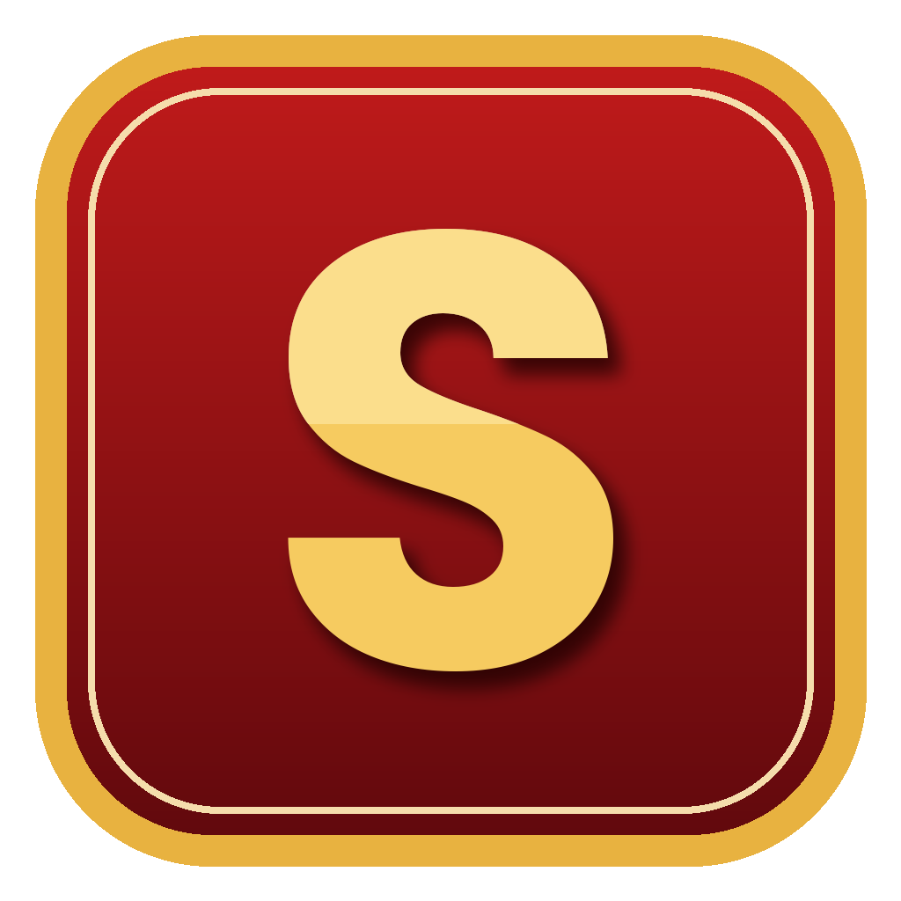

# Project Stark

Project Stark is a game server for Fortnite, built on top of [Project Reboot 3.0](https://github.com/Milxnor/Project-Reboot-3.0) by Milxnor.

Below are the key points about this project:

## Features

1. **S3-S15 Support**: The project includes support for Fortnite seasons 3 through 15 (main testing is done on 14.60).
2. **S1-S2 & S16-S19 Compatibility**: Seasons 1 and 2, and Season 16 through 19 might not work perfectly.
3. **Bots**: Fill your lobby with AI bots that wander spawn island, jump from the bus, skydive, loot, heal, follow the storm and fight. Bot count, skill, looting, fighting and emotes can be changed in the Bots section of the server window. (Work in progress.)
4. **Stability Fixes**: The bus is now started on the game thread (fixes random crashes when pressing Start Bus), and bots that break are removed instead of crashing the server.
5. **Lategame Enhancements**: Lategame improvements are planned for the future.

## Quick Start (easiest)

1. Go to **[Releases](https://github.com/Timmeyfn/ProjectStark/releases/latest)** and download **ProjectStark.zip**.
2. Extract it anywhere and run **ProjectStark.exe** (make a desktop shortcut if you like).
3. **Play** tab: add your **Fortnite 14.60** folder (game files are not included; Epic's files can't be shared here).
4. **Host** tab: Start hosting. Then **Play**: Launch Fortnite.
5. In the Project Stark server window, open **Bots**, pick how many, then press Start Bus.

Everything (launcher, login server and ProjectStark.dll) is built automatically by GitHub from this source code, so there's nothing to install.

Settings → **Project Stark** has build/edit sensitivity and reset on release.

## Building it yourself

1. Clone this repository.
2. Build the project with Visual Studio 2022 (**Release | x64**).
3. Use your built DLL the same way as above: Settings → Internal files → Game server type **Custom**, and point "Game server" at the built `x64\Release\Project Reboot 3.0.dll`.

## Planned

- [x] Project Stark Launcher (a themed version of Reboot Launcher) in [`Launcher`](Launcher/STARK_BUILD.md), started from a desktop shortcut
- [x] Lobby locker saves between game restarts (skin, pickaxe, glider, emotes), in the Project Stark Launcher
- [ ] Your locker skin carries into the match instead of turning into a default
- [x] Project Stark Launcher has its own logo/icon instead of Reboot's
- [ ] Bot gun animations (weapons properly equipped on the bots)
- [x] Play with friends without Radmin VPN: the host's router port opens automatically (UPnP) and the server window shows the address to share
- [ ] Friends list / party invites inside the launcher
- [ ] Client settings: Edit/Reset on release (Edit only / Edit & Reset / Reset only), build and edit sensitivity

## Contributing

Contributions are welcome! Feel free to create pull requests or report issues on the GitHub repository.

## License

This project is licensed under the BSD-3-Clause license, the same as the original Project Reboot 3.0 (see `LICENSE`).

---

**Note**: Project Stark is a work in progress, and further updates and enhancements are planned. Explore, experiment, and contribute to make it even better! 🚀
